Juiz de Fora, MG — Brasil · Mais de 10 anos de experiência em desenvolvimento e DevOps

## Sobre mim

Sou Tech Lead e desenvolvedor fullstack, formado em Sistemas de Informação. Lidero times em projetos com microsserviços, automatizo infraestrutura e entrego pipelines CI/CD, GitOps e DevSecOps com observabilidade de ponta a ponta. Gosto de compartilhar conhecimento através da tecnologia em favor da evolução.

## Stack principal

**Linguagens**

**Backend e frontend**

**CI/CD e GitOps**

**Containers e infraestrutura**

**DevSecOps e observabilidade**

**Mensageria e dados**

## Estudando agora

- Pós-graduação em Engenharia de IA Aplicada — UNIPDS (2026–2027)
- Desenvolvimento orientado a IA: SDD, RAG, MCP e Skills
- Inglês — EnglishBay

## Trajetória

| Período | Cargo | Empresa |
| --- | --- | --- |
| 2024 – atual | Tech Lead | Techlead IT Solutions |
| 2022 – 2024 | Analista de Desenvolvimento Sênior | Techlead IT Solutions |
| 2021 – 2022 | Analista de Desenvolvimento Pleno | Techlead IT Solutions |
| 2019 – 2021 | Desenvolvedor Fullstack | Inspell Softwares |

## Vamos conversar

